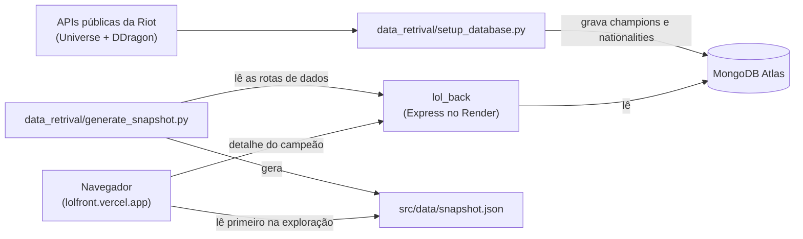

# LoL Front

Frontend estático (HTML/CSS/JS puro) para navegar por regiões (nacionalidades) e campeões de League of Legends. Consome a API do [lol_back](https://github.com/IannCarvalho/lol_back).

**Live:** https://lolfront.vercel.app (frontend na Vercel) · backend em https://lol-back-6zld.onrender.com (Render) · banco no MongoDB Atlas.

> Deploy contínuo: cada push na branch `main` publica automaticamente na Vercel.

## Arquitetura



O frontend abre a exploração a partir do snapshot estático (instantâneo, mesmo com o backend dormindo) e pede ao [lol_back](https://github.com/IannCarvalho/lol_back) o detalhe de cada campeão. Os detalhes estão na seção [Dados e cold start](#dados-e-cold-start).

## Estrutura

O JavaScript é organizado em **ES Modules nativos** (sem framework nem bundler): cada arquivo tem uma responsabilidade e o `main.js` orquestra os demais.

```
lol_front/
├── index.html
├── favicon.ico
├── _redirects            # fallback SPA (Netlify)
├── vercel.json           # fallback SPA (Vercel)
├── .github/workflows/
│   └── ci.yml            # CI: pytest do seed + checagens do front
├── src/
│   ├── css/              # tokens (paleta, tipografia, medidas), base, conteúdo,
│   │                     # colunas, componentes, animações e responsivo
│   ├── data/             # snapshot.json (retrato estático das rotas de dados)
│   ├── imagens/          # logo.png
│   └── js/
│       ├── config.js     # configuração de runtime (BASE_URL) + wake do backend
│       ├── main.js       # ponto de entrada: orquestra dados, UI e rotas
│       ├── api.js        # camada de dados (snapshot + backend, cache, timeouts)
│       ├── router.js     # roteamento por History API (URLs limpas)
│       ├── keyboard.js   # navegação por teclado (setas)
│       └── ui/           # componentes de interface
│           ├── background.js  # crossfade da imagem de fundo
│           ├── content.js     # título (nome + epíteto), descrição, breadcrumb, erro
│           ├── lists.js       # emblemas das colunas + seleção por coluna
│           ├── tooltip.js     # tooltip com o nome do emblema
│           └── loader.js      # indicador de carregamento
├── tests/js/             # testes node:test do api.js e do router.js
└── data_retrival/
    ├── setup_database.py     # popula o MongoDB com dados da Riot/DDragon
    ├── generate_snapshot.py  # gera o src/data/snapshot.json a partir do backend
    ├── requirements.txt
    ├── requirements-dev.txt  # dependências de teste (pytest)
    ├── .env.example
    └── tests/                # testes pytest dos dois scripts
```

> Como usa ESM (`<script type="module">`), o app precisa ser servido via HTTP (não abre por `file://`).

## Identidade visual

- **Tokens** em `src/css/tokens.css`: paleta inspirada no cliente do LoL (dourados, azul-petróleo Hextech para o foco de teclado, azul-noite no fundo), cores semânticas, fontes e medidas. Os outros arquivos de CSS usam só essas variáveis.
- **Tipografia**: [Cinzel](https://fonts.google.com/specimen/Cinzel) nos títulos (serifa clássica, na linha da Beaufort usada pela Riot) e [Rubik](https://fonts.google.com/specimen/Rubik) no texto, via Google Fonts.
- **Título**: regiões mostram o nome; campeões mostram o nome e, logo abaixo, o epíteto em dourado (ex.: "Jinx" / "o Gatilho Desenfreado").
- **Seleção**: a coluna Regiões destaca a região de contexto (inclusive quando se está vendo um campeão) e a coluna Campeões destaca o campeão; o emblema selecionado leva `aria-current`.
- **Responsivo**: no desktop, duas colunas de emblemas à direita, e o texto nunca passa por baixo delas. Em telas baixas (ex.: celular deitado), logo e título ficam compactos. Em até 600px, as colunas viram duas faixas roláveis no rodapé.

## Dados e cold start

A tela de exploração (nacionalidades e campeões por região) abre a partir de um **snapshot estático** servido junto do frontend em `src/data/snapshot.json`. Como esses dados só mudam quando o banco é re-semeado, o `api.js` lê do snapshot primeiro: a tela pinta na hora, mesmo com o backend no plano gratuito do Render ainda acordando. Se o snapshot faltar ou estiver inválido, o `api.js` cai de volta para a chamada ao backend.

O detalhe de um campeão (`/champion/:slug`) é pedido ao backend, que continua sendo a fonte de verdade. Se ele não responder em ~5s (cold start) ou falhar, o `api.js` usa os dados do próprio snapshot, que já traz a lore de cada campeão. Um 404 do backend é resposta definitiva e mostra a mensagem de "não encontrado". Chamadas ao backend sem alternativa têm timeout de 60s (acima de um cold start típico), e o snapshot tem 10s antes de cair para o backend.

O `api.js` cacheia em memória as nacionalidades, os campeões por região e os detalhes já carregados. Revisitar algo não refaz a leitura, e pedidos repetidos ao mesmo campeão reaproveitam a busca em andamento.

A carga inicial também trata o cold start:
- o `config.js` dispara um fetch *fire-and-forget* ao `/status` assim que carrega, para o Render começar a acordar antes de qualquer chamada que precise dele;
- o `main.js` busca regiões e campeões em paralelo (`Promise.all`) e mostra *skeletons* nas colunas;
- se uma carga (inicial ou de navegação) passar de ~1,2s, aparece um aviso discreto: "Carregando dados de Runeterra…".

A navegação segue a regra "a última vence": se o usuário clicar em outro emblema enquanto uma resposta lenta ainda não chegou, a resposta antiga é descartada e não sobrescreve a tela.

## Rodando o frontend

Não há build step. Como o app usa roteamento por **History API** (URLs com path limpo, ver seção Rotas), o servidor precisa fazer *fallback* para o `index.html` em rotas desconhecidas. Use um servidor estático com suporte a SPA:

```bash
# recomendado (faz o fallback com a flag -s)
npx serve -s -l 5500
```

Depois acesse `http://localhost:5500`.

> `python -m http.server` funciona para a raiz, mas **não** faz fallback: recarregar em `/region/zaun` daria 404. Prefira `serve -s` (ou outro servidor com fallback) durante o desenvolvimento.

## Rotas

O estado da navegação fica na URL (dá para recarregar e compartilhar):

| URL                 | Conteúdo                        |
|---------------------|---------------------------------|
| `/`                 | Runeterra (tela inicial)        |
| `/region/:slug`     | Uma região/facção (ex.: `/region/zaun`) |
| `/champion/:slug`   | Um campeão (ex.: `/champion/garen`); a coluna Campeões mostra a região dele |

## Deploy

O frontend está publicado na **Vercel** em https://lolfront.vercel.app. Por ser estático (sem build step), o deploy é direto — o `vercel.json` cuida do *fallback* SPA.

O repositório já inclui as configs de *fallback* SPA para os principais hosts:
- **Vercel**: `vercel.json` (rewrites para `/index.html`)
- **Netlify**: `_redirects` (`/* /index.html 200`)

Em outros servidores (ex.: Nginx), configure o equivalente: `try_files $uri /index.html;`.

### Configurando o backend

A URL do backend fica em `src/js/config.js`. O arquivo detecta o ambiente
automaticamente: em `localhost` usa o backend local; em produção usa a URL
pública do Render.

```js
const PROD_BACKEND_URL = "https://lol-back-6zld.onrender.com";
const LOCAL_BACKEND_URL = "http://localhost:5000";
```

Para apontar para outra instância do `lol_back`, ajuste `PROD_BACKEND_URL`. O backend só aceita (CORS) as origens configuradas nele — veja a seção CORS do [README do lol_back](https://github.com/IannCarvalho/lol_back/blob/master/README.md#cors). Em origens não liberadas (ex.: previews da Vercel), a exploração e o detalhe dos campeões continuam funcionando pelo snapshot.

## Populando o banco (data_retrival)

O script `setup_database.py` busca campeões e facções nas APIs públicas da Riot (Universe) e DDragon e grava no MongoDB.

```bash
cd data_retrival
pip install -r requirements.txt
cp .env.example .env   # e preencha MONGO_URL
python setup_database.py
```

> A `MONGO_URL` é lida de variável de ambiente (via `.env`). Nunca faça commit do `.env` — ele está no `.gitignore`.

⚠️ O script recria a base `lol` do zero (`drop_database`), mas só **depois** de baixar e montar todos os dados em memória: se a Riot falhar no meio, ou não vier nenhum campeão ou nenhuma facção, ele aborta sem tocar no banco. Cada request tem timeout de 30s, e um campeão cuja request falhe (ou sem correspondência no DDragon) é pulado com aviso, sem derrubar o script.

### Regenerando o snapshot estático

Depois de re-semear o banco, atualize o snapshot para refletir os novos dados:

```bash
# o backend precisa estar no ar e apontando para o banco já populado
python data_retrival/generate_snapshot.py
```

O script lê as rotas de dados do backend (default: a URL de produção; passe outra como argumento, ex.: `python data_retrival/generate_snapshot.py http://localhost:5000`) e grava o `snapshot.json`. Ele lê das rotas em vez do Mongo direto para o formato do arquivo bater exatamente com o que o backend serve, sem duplicar a serialização. Se o backend devolver zero nacionalidades (banco vazio), o script aborta e **não** sobrescreve o snapshot atual. Faça commit do `snapshot.json` atualizado junto com o deploy.

## Testes e CI

```bash
# testes do frontend (api.js e router.js), sem dependências — Node 22.12+ (o CI usa o 24)
node --test "tests/js/**/*.test.mjs"

# testes do seed (sem rede nem MongoDB: as chamadas externas são mockadas)
cd data_retrival
pip install -r requirements-dev.txt
pytest
```

O CI (GitHub Actions, `.github/workflows/ci.yml`) roda a cada push e pull request para a `main`, em dois jobs:
- **seed**: Python 3.12, `pytest data_retrival`;
- **frontend**: Node 24, checagem de sintaxe de todo o `src/js` (`node --check`), validação do formato do `snapshot.json` e os testes `node:test`.
